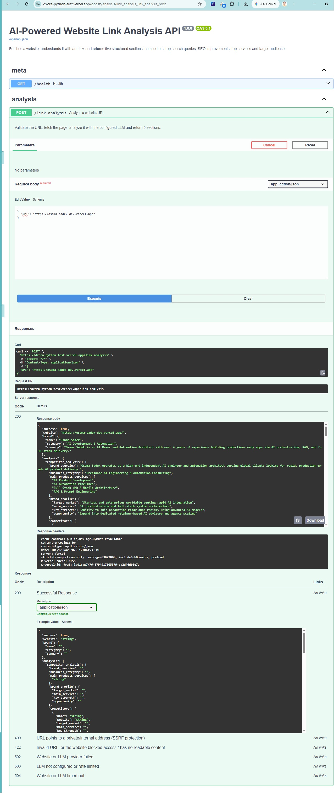

# AI-Powered Website Link Analysis API

A FastAPI service that takes a website URL, fetches and cleans the page, sends the content to an LLM and returns
**five structured sections**: competitors, top 5 target search queries, SEO improvements, top 5 services and
target audience.

- **Stack:** Python 3.10+, FastAPI, Uvicorn, Pydantic v2, HTTPX, BeautifulSoup, python-dotenv
- **Endpoint:** `POST http://localhost:4000/link-analysis`
- **Docs (Swagger UI):** http://localhost:4000/docs
- **Live demo (Vercel):** https://dxora-python-test.vercel.app/docs
- **LLM:** Google Gemini (`gemini-3.5-flash-lite`, fallback `gemini-3.8-flash`) by default, both with a **free tier**, also supports OpenAI (and OpenAI-compatible APIs) and Anthropic Claude, chosen in `.env`
- **No mock mode.** Every result comes from a real page fetch and a real LLM call. If something fails, the API says so.

## Setup

```bash
git clone <this-repo-url>
cd <repo-folder>

python -m venv .venv
source .venv/bin/activate          # Windows: .venv\Scripts\activate
pip install -r requirements.txt

cp .env.example .env               # Windows: copy .env.example .env
# edit .env and paste your key (see below)
```

**Free key (no credit card):** create a Gemini API key at https://aistudio.google.com/apikey and set
`GEMINI_API_KEY` in `.env`. Free-tier content may be used by Google to improve its products, so do not send
confidential pages with a free key.

To use another provider set `LLM_PROVIDER=openai` (+ `OPENAI_API_KEY`) or `LLM_PROVIDER=anthropic`
(+ `ANTHROPIC_API_KEY`). `LLM_MODEL` / `LLM_FALLBACK_MODEL` override the default models.

## Run

```bash
uvicorn app.main:app --host 0.0.0.0 --port 4000
```

## API

### `POST /link-analysis`

```bash
curl -X POST http://localhost:4000/link-analysis \
  -H "Content-Type: application/json" \
  -d '{"url": "https://example.com"}'
```

A URL without a scheme (`example.com`) is accepted and defaults to `https://`.

**Response `200 OK`** (shape; values depend on the real website and the LLM):

```json
{
  "success": true,
  "website": "https://example.com/",
  "brand": { "name": "", "category": "", "summary": "" },
  "analysis": {
    "competitor_analysis": {
      "brand_overview": "",
      "business_category": "",
      "main_products_services": [],
      "brand_profile": { "target_market": "", "main_service": "", "key_strength": "", "opportunity": "" },
      "competitors": [
        { "name": "", "website": null, "target_market": "", "main_service": "", "key_strength": "",
          "weaknesses": [], "opportunity": "", "source": "ai_suggestion" }
      ],
      "strengths": [],
      "opportunities": []
    },
    "target_search_queries": [
      { "query": "", "platforms": ["Google", "LinkedIn"], "intent": "", "business_relevance": "", "target_audience": "" }
    ],
    "seo_improvements": {
      "primary_keyword": "", "secondary_keywords": [], "long_tail_keywords": [], "business_keywords": [],
      "recommended_title": "", "title_structure": "", "meta_description": "",
      "supporting_content": [{ "type": "FAQ", "title": "", "purpose": "" }],
      "current_title": "", "current_meta_description": ""
    },
    "top_services": [
      { "name": "", "description": "", "target_industry": "", "target_customer": "", "main_benefit": "", "source": "website" }
    ],
    "target_audience": {
      "primary_audience": [], "secondary_audience": [], "industries": [], "business_types": [],
      "customer_profiles": [], "geographic_focus": "", "customer_needs": [], "customer_interests": [],
      "recommended_marketing_segments": [{ "audience": "", "business_type": "", "requirement": "" }]
    }
  },
  "notes": ["Competitors are AI-generated suggestions ...", "Search volumes are not included ..."],
  "meta": { "llm_provider": "gemini", "llm_model": "gemini-3.5-flash-lite", "input_tokens": 0, "output_tokens": 0,
            "llm_latency_ms": 0, "total_latency_ms": 0, "cached": false, "content_chars": 0, "content_truncated": false }
}
```

### Real sample (trimmed)

Produced on 17 Nov 2026 by the deployed app (Vercel, `gemini-3.5-flash-lite`) for the author's own portfolio site
`https://osama-sadek-dev.vercel.app`. Long lists are shortened with `...`; the full response was returned by the API.

```json
{
  "success": true,
  "website": "https://osama-sadek-dev.vercel.app/",
  "brand": { "name": "Osama Sadek", "category": "AI Development & Automation", "summary": "Osama Sadek is an AI Maker & Automation Architect specializing in building production-ready apps via AI orchestration, RAG, and full-stack delivery." },
  "analysis": {
    "competitor_analysis": {
      "business_category": "Freelance AI Engineering & Full-Stack Development",
      "competitors": [
        { "name": "Upwork", "website": "https://upwork.com", "weaknesses": ["High platform fees", "..."], "source": "ai_suggestion" },
        { "name": "Toptal", "website": "https://toptal.com", "weaknesses": ["Expensive hourly rates", "..."], "source": "ai_suggestion" },
        { "name": "Braintrust", "website": "https://usebraintrust.com", "weaknesses": ["Complex tokenomics and governance structure", "..."], "source": "ai_suggestion" }
      ]
    },
    "target_search_queries": [
      { "query": "hire AI automation engineer", "platforms": ["Google", "LinkedIn"], "intent": "Commercial", "target_audience": "Startup founders and tech leads" }
    ],
    "seo_improvements": {
      "primary_keyword": "AI Automation Engineer",
      "recommended_title": "Osama Sadek | AI Automation Engineer & AI Maker",
      "current_title": "Osama Sadek — AI Maker & AI Automation Engineer"
    },
    "top_services": [
      { "name": "AI Automation Architectures", "target_industry": "Logistics, Legal, Tech", "source": "website" },
      { "name": "AI Product Strategy & Prompt Engineering", "source": "inferred" }
    ],
    "target_audience": { "primary_audience": ["Startup Founders", "CTOs", "Product Managers"], "geographic_focus": "Worldwide (Remote)" }
  },
  "notes": ["Competitors are AI-generated suggestions ...", "Search volumes are not included ..."],
  "meta": { "llm_provider": "gemini", "llm_model": "gemini-3.5-flash-lite", "input_tokens": 1185, "output_tokens": 2332,
            "llm_latency_ms": 13350, "total_latency_ms": 13566, "cached": false, "content_chars": 964, "content_truncated": false }
}
```

How the spec's honesty rules are handled:

| Requirement | Implementation |
|---|---|
| Use the actual website content | Only the extracted text of the submitted page is sent; the prompt forbids generic filler |
| Mark inferred services | Every service has `source: "website"` or `"inferred"` |
| Competitors = credible research or clearly marked suggestion | Every competitor has `source: "ai_suggestion"`, domains are only kept when they look valid, and a note explains that no live research was done |
| Do not invent search volumes | No volume fields exist; the prompt forbids statistics; a note states this in every response |
| Distinguish measured from estimated | `meta` returns the measured token usage and latency of each call (see LLM section) |

### Errors

All errors use the same envelope: `{"success": false, "error": "...", "details": [{"field": "...", "message": "..."}]}`.

| Status | When |
|---|---|
| 400 | URL points to a private/internal address (SSRF protection) |
| 422 | Invalid URL; website blocked us (401/403/429), page not found, not HTML, or no readable text (JS-only page) |
| 502 | Website returned 5xx / unreachable, or the LLM failed / returned an unusable answer twice |
| 503 | LLM not configured (missing key) or rate limited |
| 504 | Website or LLM timed out |

## Security

- **SSRF protection** (`app/utils/validators.py`): only `http(s)` on ports 80/443, no credentials in the URL, and the host
  must resolve **only to public IPs** (loopback, private, link-local such as `169.254.169.254`, CGNAT, IPv4-mapped IPv6,
  etc. are rejected). Redirects are followed manually and **every hop is re-validated**.
- Download limits: 2 MB of HTML, timeouts, content-type check.
- Prompt-injection hardening: page text is wrapped in `<website_content>` tags and the system prompt tells the model it is
  untrusted data. Output is parsed and validated with Pydantic before being returned.
- API keys are read only from environment variables; `.env` is git-ignored; keys are sent in headers, never in URLs or logs.
- **Known limitation:** the IP check happens before the connection, so a DNS-rebinding attack between the check and the
  connection is theoretically possible. For production, pin the connection to the validated IP or run the service behind an
  egress proxy / firewall that blocks internal ranges.

## Tests

The tests run offline (no network, no API keys); the LLM and HTTP fetch are replaced by fakes:

```bash
python -m pytest -v
```

The suite has 51 tests. They cover URL/SSRF validation, redirect re-validation, HTTP error mapping, HTML extraction, JSON parsing, competitor
cleanup, retry and fallback logic, caching and every error status.

## Project structure

```
app/
├── main.py                       FastAPI app, POST /link-analysis, error handlers
├── config.py                     Environment variables / .env, default models
├── schemas.py                    Pydantic request / response models (the 5 sections)
├── services/
│   ├── website_extractor.py      Safe fetch + HTML cleaning
│   ├── llm_service.py            Gemini / OpenAI / Anthropic HTTP clients, JSON parsing
│   ├── analysis_service.py       Pipeline, prompts, retry + fallback, caching
│   └── competitor_service.py     Cleans and labels the competitor list
└── utils/
    ├── validators.py             URL validation + SSRF protection
    └── cache.py                  In-memory TTL cache
tests/test_link_analysis.py
```

## Deploy on Vercel (optional)

1. Import the repo in Vercel (framework: FastAPI / Other). `vercel.json` raises the function limit to 60 s.
2. In **Project -> Settings -> Environment Variables** add `GEMINI_API_KEY` (type **Secret**, never commit it). The other
   variables from `.env.example` are optional because the defaults are already `gemini-3.5-flash-lite` with
   `gemini-3.8-flash` as fallback.
3. **Redeploy** (variables only apply to new deployments), then open `/docs`.

The in-memory cache is per serverless instance there.

---

# LLM platform and model research

> **Prices were checked on 17 Nov 2026.** Provider pricing changes often (several Gemini prices below double on
> 1 Jan 2027), so re-check before budgeting. **Accuracy and speed were not benchmarked by me** (see "Measured vs
> estimated"), so no model is claimed to be "the most accurate".

## A. Comparison

Estimates below assume a typical company page: about **6,000 input + 2,500 output tokens**. A real run on a small page measured 1,169 input + 2,314 output tokens (see section D).

| Provider | Model (API id) | Input / Output per 1M tokens | Est. cost per analysis | Free tier | JSON output | Context window |
|---|---|---|---|---|---|---|
| Google | `gemini-3.8-flash` | $0.75 / $3.75 until 31 Dec 2026, then $1.50 / $7.50 | ~$0.014 (then ~$0.028) | **Yes** | Native JSON mode (`responseMimeType`) | Not confirmed on the pricing page; far above what this app sends |
| Google | `gemini-3.5-flash-lite` | $0.30 / $2.50 | ~$0.008 | **Yes** | Native JSON mode | Not confirmed on the pricing page |
| Anthropic | `claude-haiku-5-5` | $0.10 / $0.50 for prompts up to 100k tokens ($0.50 / $2.50 above) | ~$0.002 | No | Prompt-enforced JSON + parser/validation retry | 1M |
| Anthropic | `claude-sonnet-5-5` | $2 / $10 | ~$0.037 | No | Prompt-enforced JSON + retry | Not re-verified |
| OpenAI | `gpt-5.4-nano` | $0.20 / $1.25 | ~$0.004 | No | `response_format: json_object` | ~400K (third-party listing) |
| OpenAI | `gpt-5.4-mini` | $0.75 input (official page snippet); output rate not re-verified | n/a | No | `response_format: json_object` | Not re-verified |

Sources: Google rows from the official Gemini API pricing page (ai.google.dev). Claude Haiku/Sonnet rates from Anthropic's
launch announcements as reported by several outlets and price trackers (I could not open Anthropic's own page).
OpenAI nano rates from third-party price trackers; the mini input price is from openai.com's pricing page.
Cost = `6000 × input + 2500 × output`; thinking tokens, if any, are billed as output, so the real figure can be higher.

| Criteria | Notes |
|---|---|
| Response speed | **Measured only for `gemini-3.5-flash-lite`:** 6.4-13.4 s for the LLM call in 3 runs (section D). Other models were **not** measured; small "flash / lite / nano / haiku" models are expected to be the fastest. The API returns the measured `llm_latency_ms` of each call |
| Accuracy | **Not benchmarked.** One third-party test reported that Haiku 5.5 used about 3x more output tokens per task than GPT-6 Luna, which would raise its real cost above the estimate |
| JSON reliability | Gemini and OpenAI offer a JSON mode; Claude relies on the prompt. In all cases the app parses and validates the result with Pydantic and retries once, then falls back to a second model |

## B. Model selection

Priority for this project: low cost, reliable JSON, good understanding of a page's content.

- **Default: `gemini-3.5-flash-lite`.** It has a **free tier** (development, tests and demo cost nothing), a native JSON
  mode, a low paid price, and it was the model that answered reliably and quickly in my real runs (7-13 s per analysis, 3 runs).
- **Automatic fallback: `gemini-3.8-flash`** (also free-tier, stronger but pricier). It is used when the main model is
  rate limited, down or returns an invalid answer twice. In my first local run the larger model was the main one and about
  100 s were lost before the fallback answered (cause not diagnosed; Gemini also returned a transient HTTP 503 once), which is
  why the small model is now the default.
- **Cheapest paid option at scale: `claude-haiku-5-5`** (about $0.001-0.002 per analysis on these token counts). Switch with
  `LLM_PROVIDER=anthropic`. If the quality of its competitor and SEO sections is not good enough in your own test,
  use `claude-sonnet-5-5`.

## C. Cost optimization (implemented unless noted)

1. **Clean before sending:** scripts, styles, SVG, forms, nav, footer are removed; only headings, paragraphs and list items
   are kept; duplicate lines are dropped (`website_extractor.py`).
2. **Hard cap on input:** `MAX_CONTENT_CHARS` (default 12,000 characters ≈ 3,000 tokens) and a 2 MB download limit.
3. **Short prompt, strict schema:** one compact JSON template, "keep every string concise", exactly 5 queries / 5 services.
4. **Single LLM call** produces all five sections (no per-section calls).
5. **Cheap model first, stronger model only as fallback**, never the other way round.
6. **Cache:** the same URL + model is answered from an in-memory TTL cache (`CACHE_TTL_SECONDS`, default 1 hour).
7. **No wasted retries:** only invalid JSON (1 retry per model), a transient provider 5xx (1 retry after 2 s) and retryable errors (429/timeouts, which go straight to the fallback model) trigger another call.
8. **Fail before spending:** invalid URLs, SSRF, missing key and unreachable/empty sites are rejected before any LLM call.
9. *Possible next steps:* provider batch APIs (about half price) for bulk jobs, prompt caching for the fixed system prompt,
   and a persistent cache (Redis) in production.

## D. Final recommendation

| Item | Value |
|---|---|
| Recommended provider / model | **Google Gemini / `gemini-3.5-flash-lite`** (free tier for development and demo) |
| Fallback model | `gemini-3.8-flash` (automatic); alternative provider: Anthropic `claude-haiku-5-5` |
| Input tokens | **Measured:** 1,169-1,185 on a small page (964 characters of text). **Estimated:** ~6,000 for a typical company page (capped by `MAX_CONTENT_CHARS`) |
| Output tokens | **Measured:** 2,314-2,362 (3 runs). Estimated ~2,500 |
| Cost per analysis | **$0 on the free tier.** Paid, at the measured tokens: ~$0.006 (flash-lite), ~$0.0095 (3.8 Flash until 31 Dec 2026), ~$0.0013 (Haiku 5.5, but see the note on its token use above). At the estimated 6,000 / 2,500 tokens: ~$0.008 (flash-lite) |
| Response time | **Measured:** 6.4-13.4 s for the LLM call (3 runs) and 7.0-13.6 s end to end on the deployed app; latency varies between calls |
| Reason | Free to develop and demo, native JSON mode, small paid price, fast in practice, and a second free-tier model as fallback |
| Balancing accuracy, speed, cost | Cheap, fast model by default; strict validation; one retry; automatic fallback to a larger model; cache for repeats; upgrade to a larger model only if your own evaluation shows the cheap one is not good enough |

### Measured vs estimated

- **Measured (returned by the API in `meta` on every call):** input/output tokens, `llm_latency_ms`, `total_latency_ms`.
- **Estimated:** cost per analysis, behaviour on larger pages, other providers' speed.
- **Not done:** an accuracy benchmark. No model is claimed to be the "most accurate". To compare fairly, run the same 5-10
  websites with each `LLM_MODEL` and score services, competitors and queries by hand.

Real runs (author's portfolio site, `https://osama-sadek-dev.vercel.app`):

| Run | Where | Model that answered | Input tokens | Output tokens | LLM latency (ms) | Total (ms) | Notes |
|---|---|---|---|---|---|---|---|
| 1 | Local, Swagger | gemini-3.5-flash-lite (fallback) | 1,169 | 2,362 | 6,407 | 107,734 | Main model at that time (`gemini-3.8-flash`) did not answer; ~100 s lost before the fallback |
| 2 | Vercel production | gemini-3.5-flash-lite | 1,169 | 2,314 | 6,849 | 7,028 | Models set through environment variables |
| 3 | Vercel production (after the "3+ competitors" prompt change) | gemini-3.5-flash-lite | 1,185 | 2,332 | 13,350 | 13,566 | 3 competitors returned; slower than run 2, so latency varies between calls |

All three runs used the same small website. Add more rows by calling the API on other websites and copying the numbers from `meta`.

## Evidence of a real run

Deployed on Vercel and tested end to end (live demo: https://dxora-python-test.vercel.app/docs).

**Real response (`POST /link-analysis`)**



## Limitations

- Only the submitted page is analyzed (no site crawl); JavaScript-only pages without server-rendered text are rejected.
- Competitors come from the model's knowledge, not live research, and may be outdated.
- No search-volume data (it would require a paid data source).
- Pricing and model names change; verify them against the provider pages before relying on the numbers.
